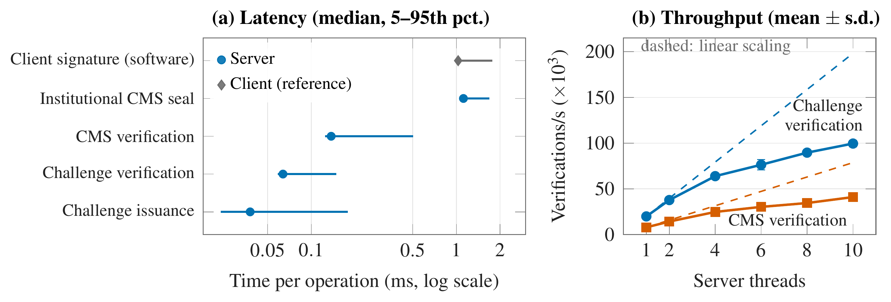

# DNIe-SignAnywhere — Evaluation Data

**Domain-bound smart-card signatures for web authentication, transaction signing and identity proofing with Peru's DNIe**

[-2E7D32?style=flat-square)](https://www.iciccds.com/)
[](https://www.iciccds.com/)
[](LICENSE)
[](#security-test-cases)
[](https://openjdk.org/)
[](https://www.bouncycastle.org/)
[](#cost-on-the-server)

**Proceedings paper, accepted** (Paper ID 77) at the [*International Conference on Intelligent Computing, Communication and Data Science*](https://www.iciccds.com/) (**ICICCDS 2027**), to appear in the proceedings published by Springer in the series *Studies in Autonomic, Data-Driven and Industrial Computing* (ADIC, Scopus-indexed).

This repository holds the **evaluation data** behind the paper: every security test case, every latency sample and every throughput run. DNIe-SignAnywhere itself is free compiled software whose source code is proprietary, so it is not included here.

---

## Overview

Peru's electronic identity card (**DNIe**) carries a qualified signing certificate, yet almost no Peruvian web service accepts it: browsers cannot talk to smart cards, and the official signer signs documents but does not authenticate users to web sites. **DNIe-SignAnywhere** connects the card to any web application through a native client and three server endpoints.

The server issues a one-time challenge, and the card signs, inside the chip, a message that binds the challenge to the **service domain** and to a **four-digit code** shown in the browser:

```
m = SIGN | d | r | k        h = SHA-256(m)        σ = RSA-sign_card(h)
      d = service domain    r = 24-byte one-time challenge (180 s)    k = browser code
```

The server **never trusts the domain in the link**: it rebuilds `m` with its own `d`, so a signature made for a look-alike domain is rejected. One primitive serves three uses:

| Use | What is signed | What the server checks |
| --- | --- | --- |
| **Passwordless authentication** | `SIGN|d|r|k` | signature over the rebuilt message, certificate chain, validity, DNI registry, single use of `r` |
| **Transaction signing** | canonical string `<id>|key:value|…` as detached CMS SignedData | CMS message digest, DNI of the signer equals DNI of the session |
| **Identity proofing** | the same challenge, before personal data change | as for authentication |

```mermaid
sequenceDiagram
    participant C as DNIe chip
    participant N as Native client
    participant B as Browser
    participant S as Server
    B->>S: 1. request challenge
    S-->>B: r (180 s), k, link
    B->>N: 2. signanywhere:// r, k, d
    N->>C: 3. PIN, MSE, PSO:CDS(SHA-256(m))
    C-->>N: σ, 90 00
    N->>S: 4. σ, certificate, r (TLS)
    Note over S: 5. rebuild m with own d, verify σ,<br/>chain, validity, DNI; mark r as used
    B->>S: 6. poll status
    S-->>B: session for the DNI
```

## Key results

<table>
<tr><td valign="top" width="50%">

**Security test cases** (13, emulated PKI)

| Outcome | Cases |
| --- | :---: |
| As specified | **11 / 13** |
| Race in the single-use rule (T12) | found |
| Real-time relay (T13) | not detected |

</td><td valign="top" width="50%">

**Cost on the server** (Apple M1 Pro, 10 cores)

| Operation | Median |
| --- | :---: |
| Challenge verification | **0.064 ms** |
| CMS transaction verification | **0.137 ms** |
| Throughput, 10 threads | **99 500 ± 3 600 /s** |

</td></tr>
</table>

- **Domain binding works for what it was designed for.** A signature made for a look-alike domain (T2), a replayed challenge (T3), an untrusted issuer (T5), an expired certificate (T6) and an altered transaction field (T9) were all rejected.
- **A concurrency test found a race.** With 32 simultaneous submissions of the same signed challenge, two were accepted in 4 of 500 trials (and 5 of 500 in a repeat run). The single-use check read, tested and wrote the challenge in separate steps; an atomic compare-and-set fixes it.
- **Domain binding is not origin binding.** A custom URL scheme cannot tell the client which page opened it, so a phishing page can relay a genuine challenge in real time (T13). The remedy is to deliver the session to the browser that the client itself opens at `d`, as the German eID client does.
- **The server is not the bottleneck.** Verification costs about a tenth of a millisecond; the user experience is set by the card and the PIN entry.

## Security test cases

Threat model: the attacker can **(A1)** run a look-alike web site, **(A2)** open the client with chosen parameters, **(A3)** replay or concurrently resubmit captured messages, **(A4)** present self-issued or expired certificates and **(A5)** alter transaction data in transit. Malware that uses the card after PIN entry is out of scope.

| ID | Case | Threat | Expected | Obtained |
| --- | --- | :---: | :---: | :---: |
| T1 | Valid domain-bound challenge signature | – | accept | ✅ accept |
| **T2** | **Signature made for a look-alike domain** | A1, A2 | reject | ✅ reject |
| T3 | Replay of an already signed challenge | A3 | reject | ✅ reject |
| T4 | Unknown or forged challenge identifier | A2 | reject | ✅ reject |
| T5 | Certificate from an authority imitating the issuer | A4 | reject | ✅ reject |
| T6 | Expired signing certificate | A4 | reject | ✅ reject |
| T7 | Valid signature with another citizen's certificate | A4 | reject | ✅ reject |
| T8 | CMS-signed transaction, intact | – | accept | ✅ accept |
| T9 | CMS-signed transaction, one field altered | A5 | reject | ✅ reject |
| T10 | Transaction signed by another card holder | A5 | reject | ✅ reject |
| T11 | Server seal applied and verified | – | accept | ✅ accept |
| **T12** | **Same signed challenge sent by 32 threads at once (500 trials)** | A3 | reject | ⚠️ accepted twice in 4 trials |
| **T13** | **Real-time relay of a genuine challenge** | A1 | reject | ❌ accept (design limitation) |

Each expected outcome was written before the run. Results after the race fix will be added to [`data/`](data/).

## Cost on the server

<p align="center">
  
</p>

| Threads | Challenge verifications/s | CMS verifications/s |
| :---: | :---: | :---: |
| 1 | 19 826 ± 407 | 7 869 ± 139 |
| 2 | 37 729 ± 1 228 | 14 217 ± 451 |
| 4 | 63 884 ± 1 815 | 24 730 ± 1 109 |
| 6 | 76 326 ± 5 705 | 30 255 ± 1 765 |
| 8 | 89 592 ± 2 352 | 34 464 ± 3 998 |
| 10 | **99 530 ± 3 595** | **40 990 ± 1 932** |

Mean ± standard deviation of five 5-s runs per thread count. Latency: n = 2000 runs per operation after 400 warm-up runs. Apple M1 Pro (8 performance + 2 efficiency cores, 32 GB), OpenJDK 25, Bouncy Castle 1.78. These figures come from one computer that also ran other programs; they bound the cost of a single server and are not a deployment measurement.

## Comparison with existing systems

| System | Integration | Origin binding | Legal identity | Tx signing | Platforms |
| --- | --- | --- | :---: | :---: | --- |
| Web eID (Estonia) | extension + native app | yes, from the browser | yes | yes | Win, macOS, Linux |
| nPA eID (Germany) | local eID client | yes, via service certificate | yes | no | Win, macOS, mobile |
| AutoFirma (Spain) | custom URL + native app | no | yes | yes | Win, macOS, Linux |
| WebAuthn / FIDO2 | built into the browser | yes, from the browser | no | no | all |
| Firma Perú (Peru) | desktop signer | not documented | yes | documents | Win, Linux, macOS |
| **DNIe-SignAnywhere** | custom URL + native app | **domain in the signed message** | yes | yes (CMS) | Win |

## Repository layout

```
dnie-signanywhere-evaluation/
├── data/
│   ├── security_tests.csv               # 13 cases: id, case, threat, expected, obtained, as_specified
│   ├── concurrency_t12_before_fix.csv   # T12: accepted submissions per trial (500 trials)
│   ├── latency_summary.csv              # n, median, 95th percentile and mean per operation (ms)
│   ├── latency_samples.csv              # all 2000 timed runs per operation (ms)
│   └── throughput_runs.csv              # verifications/s per thread count and run
├── figures/performance.{png,pdf}        # Fig. 3 of the paper (PNG at 600 dpi)
├── real-card/                           # measurements with physical DNIe cards (see its README)
├── CITATION.cff
└── LICENSE                              # CC BY 4.0 for data and figures
```

## Data dictionary

| File | Column | Meaning |
| --- | --- | --- |
| `security_tests.csv` | `threat` | attacker capability A1–A5 exercised by the case |
| | `expected` / `obtained` | `accept` or `reject`, stated before / observed after the run |
| `concurrency_t12_before_fix.csv` | `accepted_per_trial` | submissions accepted out of 32 simultaneous ones |
| `latency_samples.csv` | `operation`, `ms` | one row per timed run |
| `throughput_runs.csv` | `threads`, `run`, `per_second` | completed verifications per second in one 5-s run |

No personal data are included: all certificates were issued by an emulated authority to synthetic identity numbers.

## Citation

```bibtex
@inproceedings{LauraMurillo2027DNIe,
  author    = {Laura-Murillo, Ramiro Pedro and Mamani-Vilca, Ecler and Vilca-Solorzano, Richar Andre},
  title     = {Domain-Bound Smart-Card Signatures for Web Authentication, Transaction Signing
               and Identity Proofing with Peru's {DNIe}},
  booktitle = {International Conference on Intelligent Computing, Communication and Data Science (ICICCDS 2027)},
  series    = {Studies in Autonomic, Data-Driven and Industrial Computing},
  publisher = {Springer},
  year      = {2027},
  note      = {Proceedings paper, accepted},
  url       = {https://github.com/Andre031222/dnie-signanywhere-evaluation}
}
```

## Authors

| Author | Affiliation | ORCID |
| --- | --- | --- |
| Ramiro Pedro Laura-Murillo (corresponding) | Universidad Nacional del Altiplano, Puno, Peru | [0000-0003-1837-4871](https://orcid.org/0000-0003-1837-4871) |
| Ecler Mamani-Vilca | Universidad Nacional Micaela Bastidas de Apurímac, Abancay, Peru | [0000-0002-5205-3660](https://orcid.org/0000-0002-5205-3660) |
| Richar Andre Vilca-Solorzano | Universidad Nacional del Altiplano, Puno, Peru | [0009-0003-2385-5263](https://orcid.org/0009-0003-2385-5263) |

## License

Data and figures: [Creative Commons Attribution 4.0 International](LICENSE). DNIe-SignAnywhere is distributed free of charge as compiled software; its source code is not part of this repository.
